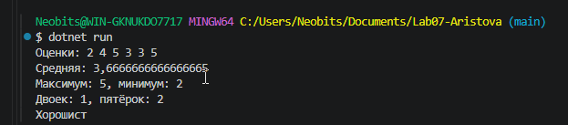
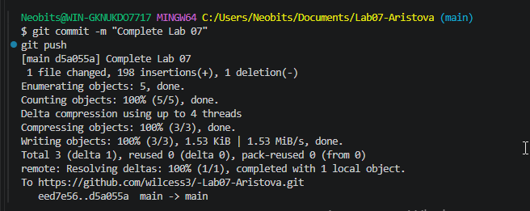

# Практическая работа №7
**ФИО:Аристова Анастасия Александровна**
**Группа:ИСП-241**
**Дата:14.10.26**
## Что изучено
- Массивы в C# начинают индексироваться с нуля, а последний элемент имеет индекс `Length - 1`
- Цикл `for` нужен, когда важен индекс элемента (например, для обмена местами или поиска позиции), а `foreach` — когда нужно просто перебрать все значения без изменения массива
- Чтобы поменять два элемента местами, нужна третья временная переменная, а разворот массива «на месте» делается циклом только до середины

